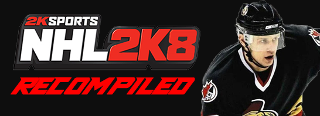
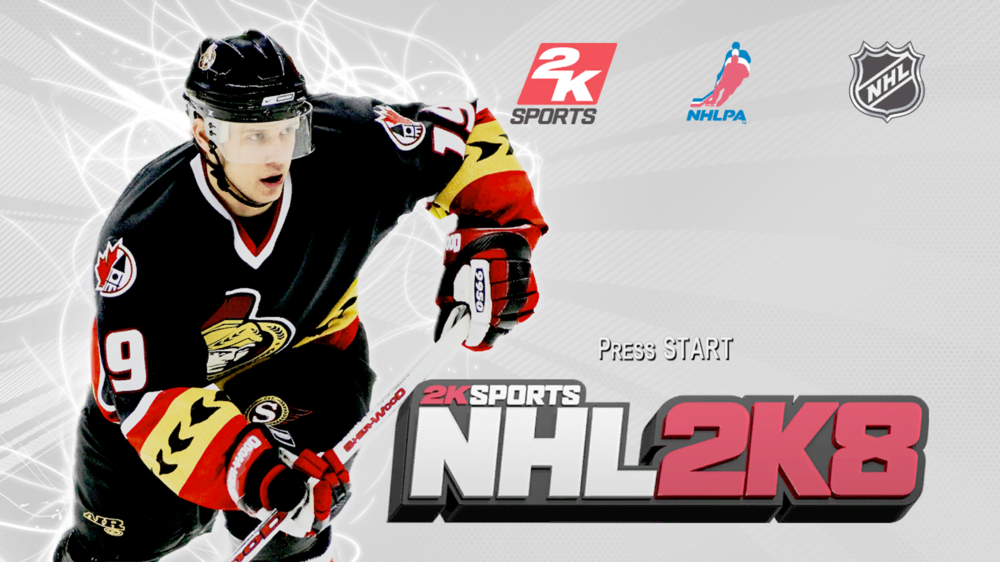
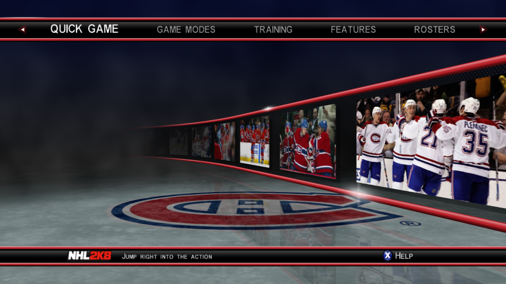
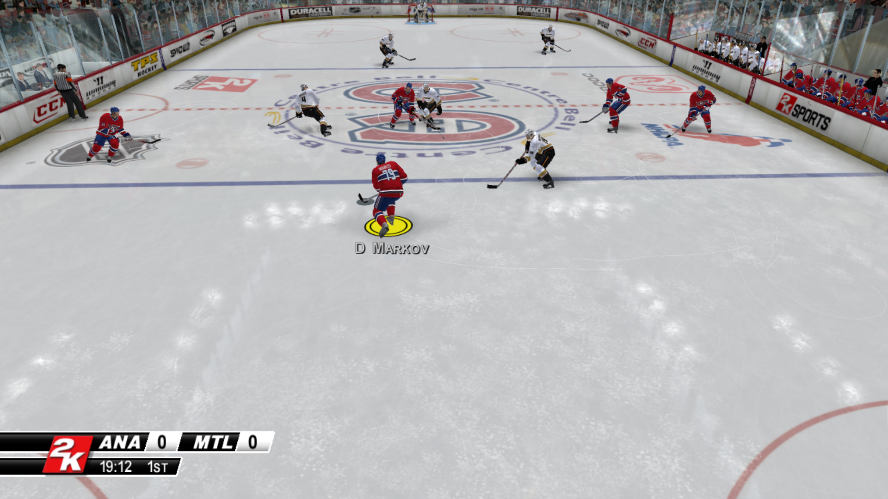

# NHL 2K8 Recompiled

A native Windows port of 2K Sports NHL 2K8 for the Xbox 360, made with static recompilation via the ReXGlue SDK.

> Unofficial fan project. Not affiliated with or endorsed by Take-Two Interactive, 2K Sports, Visual Concepts, Kush Games, the NHL or the NHLPA. All trademarks belong to their owners. This repository contains no game files and no game code. The banner image and screenshots use artwork and logos owned by their respective owners, for identification only. You need your own legally obtained copy of the game. Requests for or links to game files will be removed.

## What this is

This repository holds the pieces that make the ReXGlue SDK work with NHL 2K8: the fix list that lets the recompiler understand the game, a small launcher program, and a patch that adds the in-game music (menu music has been reported silent in the Xenia emulator). The game itself is translated on your own computer from your own copy.

## Screenshots

Taken from the running port.

## Status

Works:
- Boots, menus, quick games, franchise mode, tournaments, saving and loading
- Keyboard and controller input, including several controllers at once for local multiplayer
- Achievements
- Highlight replays during the intermissions and after the final horn, like on the console
- Soundtrack through the game's built-in music player (2K Beats)
- Custom soundtracks through the game's User Playlists screen (see "Custom soundtracks" below)
- Online play against other players on your network through the game's Xbox Live menu: Quick Match and Custom Match, player matches (see "Online play" below)
- Community rosters (.ROS files), imported with the setup program (see "Rosters" below)
- The game's own icon on the window, taskbar and shortcut

Known issues:
- Some PCs see a slowdown in busy scenes with a full crowd, most noticeably around center ice. It is smaller than in earlier versions, and some players do not see it at all (pond hockey and mini rink run smoothly).
- The F4 settings screen's "Save to config" button writes a config file the game can't read (a ReXGlue SDK bug). Edit settings by hand with forward slashes in paths.
- The first time you reach a new screen (team select, starting a game, the faceoff, after a goal), the game can stutter for a few seconds. This looks like graphics shaders being prepared and saved, and it did not repeat on later visits.
- Online: ranked matches, Play Friend invites, leaderboards and the 2K Sports service do not work. Playing over the internet through a virtual LAN has not been tested yet.

## Minimum PC

The lowest-end PC it has been tested on, where it runs well, including online play:

- CPU: 4 cores, such as an AMD Ryzen 3 3200G
- Graphics: a card that supports Direct3D 12, such as an AMD Radeon RX 550
- RAM: 16 GB (building the game uses a lot of memory)
- Windows 10 or 11, 64-bit

It may well run on less. If you try it on a lower-end PC, please open an issue and say how it went.

## What you need

- Windows 10 or 11, 64-bit, and a graphics card that supports Direct3D 12
- About 10 GB of free disk space for the build, plus room for your extracted game files
- An internet connection for the first setup (it downloads the ReXGlue SDK and its libraries)
- Your own copy of NHL 2K8 for Xbox 360 (Title ID 54540809, version 0.0.0.3), extracted so that `default.xex` and the game's other files sit in one folder. Extract your game's disc image with a tool such as Xbox Image Browser. The supported `default.xex` is 9,383,936 bytes with the SHA-256 hash `BA4E63334FAF296019657C6E86BBD444CB05646E29FA6C7B72F4BF9709CE4225`. Other releases are not supported, and setup warns you if yours is different.
- Visual Studio 2022 Community (free), with these parts ticked in the Visual Studio Installer: "Desktop development with C++", "C++ Clang Compiler for Windows" and "C++ CMake tools for Windows". Visual Studio 2022 Build Tools with the same parts also works (confirmed by a tester). Other Visual Studio versions have not been tested.
- Git for Windows (the setup program under "Easy install" can install Git and Visual Studio for you if they are missing)

## Setup

Tested on several PCs, including by outside testers. Reports from other PCs, good or bad, are welcome: please [open an issue](https://github.com/anishchandra24/NHL2K8-Recompiled/issues/new/choose).

### Easy install (recommended)

1. Download `NHL2K8-Recompiled-Setup.exe` from the [Releases page](https://github.com/anishchandra24/NHL2K8-Recompiled/releases).
2. Run it. Windows may show "Windows protected your PC" because the program is not code-signed. Click "More info", then "Run anyway". You can check your download against the SHA-256 fingerprint in the release notes. On Windows 11, Smart App Control may block it outright ("isn't signed") with no way to run it anyway; Smart App Control can only be turned off in Windows Security, App & browser control, Smart App Control settings, and on many PCs turning it off cannot be undone without reinstalling Windows. If you would rather keep it on, use the manual install below.
3. Click "Browse..." next to "Your game folder" and choose the folder that contains `default.xex`. Keep the suggested install folder or choose another short path. Optionally type a gamertag for online play (otherwise you appear as "User"). Then click "Install".
4. Wait. If Git or Visual Studio 2022 Community are missing, the program installs them with Windows' package installer (Windows asks for permission), then downloads the project and builds the game. Allow 15 to 30 minutes, plus the downloads and any Visual Studio install. At the end, a small window explains that setup will add a Windows Firewall rule for online play; click OK, then Yes when Windows asks for permission for "Network Command Shell" (or Cancel if you will never play online).
5. When it says it is done, click "Play", or use the "NHL 2K8 Recompiled" shortcut on your desktop.

If your antivirus flags the setup program: some antivirus programs (for example Microsoft Defender, as "Trojan:Win32/Wacatac.C!ml") have flagged `NHL2K8-Recompiled-Setup.exe`. This is a false positive. The "!ml" means a machine-learning guess, not a known virus: the program is new, is not code-signed, and does what an installer does, starting PowerShell, Git and Windows' package installer to download the tools and build the game. Its complete source code is in the `installer` folder of this repository, and the release notes give the file's SHA-256 fingerprint so you can check that your download is the published file. The detections are being reported to the antivirus makers as false positives. If you would rather not run it, use the manual install below, which does not use the setup program at all.

To remove it, use Settings, Apps, "NHL 2K8 Recompiled" (or the "Uninstall" button in the setup program). Uninstalling never touches your game files, and it asks before deleting your saves.

Automatic installation of Git and Visual Studio worked for an outside tester on Windows 11. If it fails for you, install the tools by hand (see "What you need") and run the setup program again, and please open an issue.

### Manual install

If you prefer to do it by hand, or the setup program does not work for you:

1. Install the tools listed above.
2. Download this project into a short folder path (long paths can break the build). Open a command prompt and run:

        git clone https://github.com/anishchandra24/NHL2K8-Recompiled.git C:\NHL2K8

3. Open the `C:\NHL2K8` folder and double-click `setup.bat`. When it asks, type the path to your extracted game folder (the folder that contains `default.xex`) and press Enter.
4. Wait. Setup checks your tools and game files, downloads the ReXGlue SDK at the exact version this project uses, applies its five SDK patches (music playback, a recompiler fix, a color fix, custom soundtracks and online play), builds the SDK, generates the game's code from your `default.xex`, builds the game, and creates a desktop shortcut. It took about 12 minutes on a fast 8-core laptop and about 21 minutes on a slower 4-core desktop, both including the downloads. Slower PCs or connections will take longer.
5. Start the game from the "NHL 2K8 Recompiled" shortcut on your desktop, or run `dist\Launch NHL 2K8.bat`.

Notes:

- At the end, setup offers to add a Windows Firewall rule named "NHL 2K8 Recompiled (online play)" so other players can reach your game: click OK, then Yes when Windows asks for permission for "Network Command Shell". Click Cancel if you will never play online; the game works without it. Run `setup.bat -NoFirewall` to skip this step.
- To set a gamertag for online play, run `setup.bat -Gamertag "YourName"` (letters, numbers and spaces, up to 15). It is remembered for later runs.
- If setup stops, it prints what went wrong. Fix the problem and run `setup.bat` again; finished steps are skipped. Detailed logs are in `.local\logs`.
- Options: run `setup.bat -NoShortcut` for no desktop shortcut, `setup.bat -SkipIcon` to skip the game's icon, or `setup.bat -Rebuild` to rebuild the SDK from scratch.
- The game's icon is read from your own copy of the game (your `default.xex`) during setup. The icon is not part of this repository.
- Setup creates a folder named `assets` inside the project. It is a link to your game folder, not a copy. Before deleting the project folder by hand, open a command prompt in it and run `rmdir assets`, so your game files are not touched. The uninstaller does this for you.
- Saves, settings and achievements are stored in `Documents\nhl2k8`, not in the project folder. Back this folder up before trying new builds.

### Updating

Run `NHL2K8-Recompiled-Setup.exe` again and choose the same install folder: it downloads the latest version of the project and rebuilds the game. With a manual install, run `git pull` in the project folder, then `setup.bat`. Your saves are not touched. The first update after v1.0 rebuilds more than usual, so allow about as long as the first install.

## Custom soundtracks

Like on the Xbox 360, the game can play your own music instead of its soundtrack.

1. Open `Documents\nhl2k8\playlists`. The game creates this folder the first time you open its User Playlists screen, or you can create it yourself.
2. Make one folder inside it for each playlist. The folder's name is the playlist's name in the game (up to 39 characters are shown).
3. Put your songs in that folder: MP3, WMA, WAV, M4A (AAC) or FLAC. Folders inside a playlist folder are not read.
4. In the game, open the User Playlists screen and tick the playlist you want.

Song titles, artists and albums are read from the files' tags. A song without tags is shown by its file name. A file that cannot be played is skipped. Playlists are read again each time you open the screen, so you can add songs while the game is running. Unlike on the Xbox 360, your music stops when you quit the game. The playlists folder is inside `Documents\nhl2k8`, so when the uninstaller asks about deleting your saves, it means this folder too.

## Online play

The game's Xbox Live mode works again, without Xbox Live: games are found on your own network, with no server involved.

1. Start the game on both PCs and choose Xbox Live in the main menu.
2. One player picks Quick Match or Custom Match first, with Game Type set to Player Match, and waits on "Locating an opponent".
3. The other player picks the same mode with the same settings. The game finds the first player's match and connects.

What works: Quick Match and Custom Match (player matches), tested on two PCs on the same Wi-Fi, playing complete games. What does not: ranked matches, Play Friend (invites), leaderboards and the 2K Sports service, which needed servers that no longer exist.

- Your gamertag is the name you typed in the setup program (or `setup.bat -Gamertag "YourName"`). Without one you appear as "User".
- Windows Firewall: setup adds a rule so other players' messages reach the game. Without it, on Wi-Fi networks that Windows marks as "Public", the PCs may not find each other or a match may stop with "A network problem has been encountered". If you skipped the rule, run setup again and click OK and Yes, or set your network to Private in Windows Settings (Network & internet, Wi-Fi, your network). To remove the rule later, open Windows Defender Firewall, Advanced settings, Inbound Rules.
- Over the internet: both players can join the same virtual LAN with a free program such as ZeroTier, Tailscale or Radmin VPN (the same idea as Hamachi), so the game sees the other PC as if it were on the same network. No router or port forwarding changes are needed. Add `--net_ip=` followed by your address on that virtual network (for example `--net_ip=10.147.17.5`) to the end of the Target box in the desktop shortcut's Properties, and if the players do not find each other, also add `--net_peers=` followed by the other player's virtual address. This has not been tested yet; if you try it, please open an issue and say whether it worked.

## Higher resolution

The game renders at 720p by default. To render at a higher resolution, close the game, right-click the "NHL 2K8 Recompiled" shortcut, choose Properties, and add ` --resolution_scale=2` to the end of the Target box (2 gives 1440p, 3 gives 4K). This needs a stronger graphics card. Changing the display resolution in the F4 settings screen only stretches the 720p picture.

## Legend player names

The classic, international and all-decade teams' unnamed players (such as "1. Center") get their real names while the game runs. The names come from the NHL 2K8 Legends Roster researched by Moto Guzzi Dude on the Operation Sports forums ([NHL2K8 XBOX 360 Roster with All Teams named PLUS 5 more Historical NHL Teams](https://forums.operationsports.com/forums/forum/hockey/other-hockey-games/nhl-2k/nhl-2k-rosters/923875-nhl2k8-xbox-360-roster-with-all-teams-named-plus-5-more-historical-nhl-teams)). Thank you! Only the player names are used; his roster file is not included. Moto Guzzi Dude, if you'd rather I didn't use your list, open an issue and I'll take it out.

You can turn the names off in setup, or start the game with `--legend_names=false`.

## Rosters

Community rosters made for the Xbox 360 version, such as updated 2007-08 rosters with the missing rookies, can be added without knowing where the game keeps its saves. Run the setup program, click "Import roster..." and choose the `.ROS` file (or a `.zip` with one inside). In the game, load it from the roster menu (Load Roster).

The "Import roster..." button is in setup program 1.8, which comes with the next release.

- The game goes back to its built-in roster each time it starts, so load your roster again after starting the game.
- Franchise and season saves cannot be imported, only rosters.
- To remove an imported roster, delete it from the game's own save menus.

## Reporting problems and test results

Found a bug, or hit a problem during setup? Please [open an issue](https://github.com/anishchandra24/NHL2K8-Recompiled/issues/new/choose). Test reports are just as welcome as bug reports, including "it worked": this project has only been tested on a few PCs, so every report helps. Useful things to include are your Windows version, your CPU, graphics card and RAM, whether setup finished, and the last lines of the logs. The setup program's log is `%TEMP%\NHL2K8-Setup.log`, and the setup steps log to `.local\logs` inside the install folder.

Please do not post or link game files. Requests for game files will be removed.

## Controls (keyboard)

Keyboard mode must be on (`mnk_mode`). Defaults:
- Start: Enter or X
- A: Space or ;  B: Backspace or '  X: L  Y: P
- Left stick (skate): W A S D   Right stick (ProStick): arrow keys
- Triggers: Q / E (or I / O)   Shoulders: 1 and 3
- Back: Tab or Z
- F3 shows performance info, F4 shows settings

An XInput game controller also works.

## How this was made

This project was developed in a chat conversation with Claude, an AI assistant by Anthropic. Claude wrote the diagnostic commands, configuration fixes, code and patches. Claude had no access to the developer's computer: everything it wrote was copied in by hand, run and tested by me, the project owner (anishchandra24), who also reported what happened, supplied knowledge of the original game, and made all decisions. Claude Code was not used. It has been tested by me on two PCs and by outside testers. The code has not been reviewed by anyone else.

## Credits

- anishchandra24: project, fixes and testing
- The ReXGlue SDK by Tom Clay and contributors
- The Xenia project (Ben Vanik and contributors), whose work the SDK's graphics code builds on
- Moto Guzzi Dude (Operation Sports forums): researched names for the legend teams' players (see "Legend player names")
- Claude (Anthropic): AI assistant used to write code, patches and diagnostics (see "How this was made")

## License

The files in this repository are released under the GNU General Public License v3.0 (see LICENSE). The license covers only what this project is entitled to license. It grants no rights to the game's files, or to anything generated from them on your own computer. The banner image and the screenshots show artwork and logos owned by their respective owners and are not covered by this license. The SDK patches modify code from the ReXGlue SDK and Xenia, which keep their own BSD licenses (see THIRD_PARTY_NOTICES.md).

