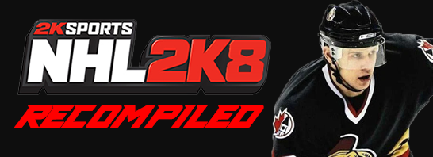
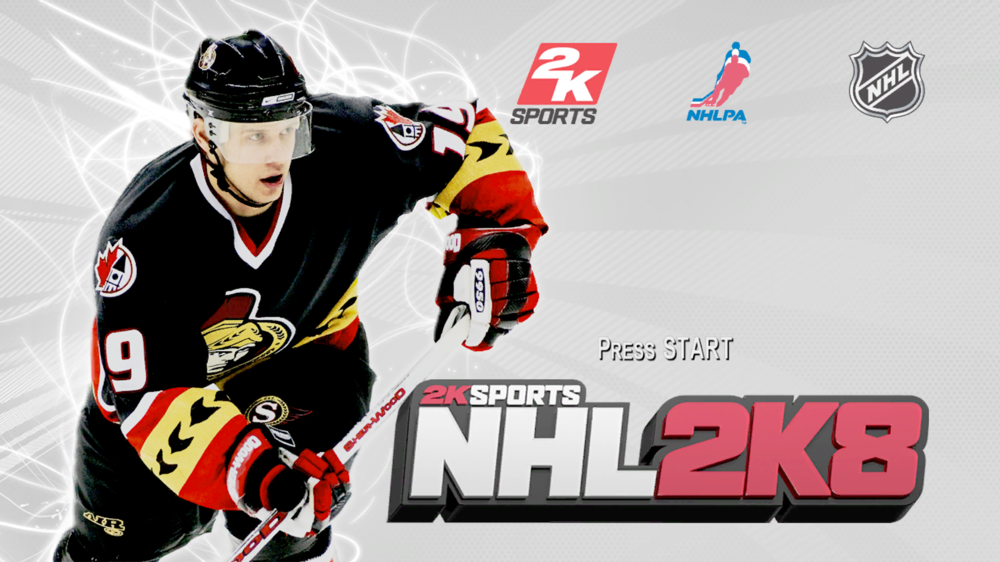
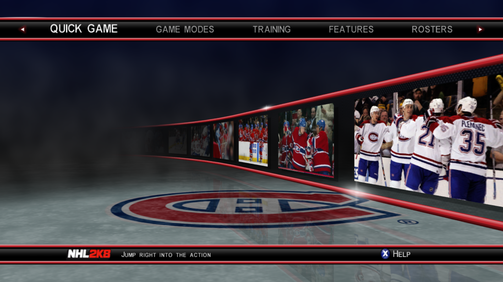
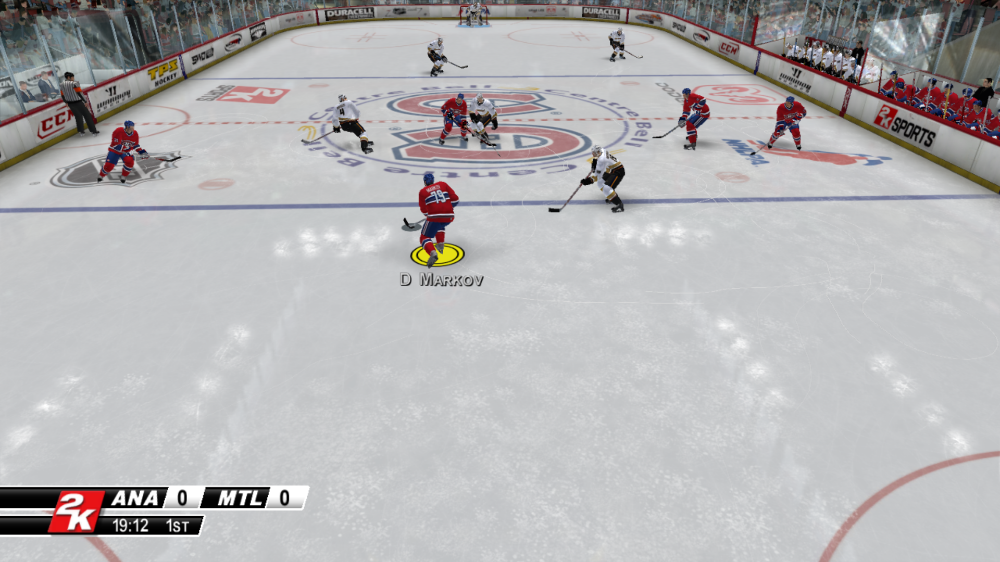

# NHL 2K8 Recompiled

A native Windows port of 2K Sports NHL 2K8 for the Xbox 360, made with static recompilation via the ReXGlue SDK.

> Unofficial fan project. Not affiliated with or endorsed by Take-Two Interactive, 2K Sports, Visual Concepts, Kush Games, the NHL or the NHLPA. All trademarks belong to their owners. This repository contains no game files and no game code. The banner image and screenshots use artwork and logos owned by their respective owners, for identification only. You need your own legally obtained copy of the game. Requests for or links to game files will be removed.

## What this is

This repository holds the pieces that make the ReXGlue SDK work with NHL 2K8: the fix list that lets the recompiler understand the game, a small launcher program, and a patch that adds the in-game music (menu music has been reported silent in the Xenia emulator). The game itself is translated on your own computer from your own copy.

## Screenshots

Taken from the running port.

## Status

Works:
- Boots, menus, quick games, franchise mode, tournaments, saving and loading
- Keyboard and controller input
- Achievements
- Soundtrack through the game's built-in music player (2K Beats)
- The game's own icon on the window, taskbar and shortcut

Known issues:
- Small colored speckles around the edges of the intro logo videos.
- Stutter in busy scenes with a full crowd (pond hockey and mini rink run smoothly).
- The F4 settings screen's "Save to config" button writes a config file the game can't read (a ReXGlue SDK bug). Edit settings by hand with forward slashes in paths.
- The first time you reach a new screen (team select, starting a game, the faceoff, after a goal), the game can stutter for a few seconds. This looks like graphics shaders being prepared and saved, and it did not repeat on later visits.
- Online features do not work.
- Custom soundtracks have not been tested.

## Tested on

- Laptop: AMD Ryzen 7 7735HS, NVIDIA RTX 4060 Laptop GPU (and AMD Radeon integrated graphics), 32 GB RAM, Windows 10 Home. Plays smoothly except in busy scenes with a full crowd.
- Desktop: AMD Ryzen 3 3200G, AMD Radeon RX 550, 16 GB RAM, Windows 10 Home. Plays, a little slower than the laptop, with the same stutter in busy scenes. Mini rink (2 on 2) was smooth.

## What you need

- Windows 10 or 11, 64-bit (only Windows 10 has been tested), and a graphics card that supports Direct3D 12
- About 10 GB of free disk space for the build, plus room for your extracted game files
- An internet connection for the first setup (it downloads the ReXGlue SDK and its libraries)
- Your own copy of NHL 2K8 for Xbox 360 (Title ID 54540809, version 0.0.0.3), extracted so that `default.xex` and the game's other files sit in one folder. Extract your game's disc image with a tool such as Xbox Image Browser. The supported `default.xex` is 9,383,936 bytes with the SHA-256 hash `BA4E63334FAF296019657C6E86BBD444CB05646E29FA6C7B72F4BF9709CE4225`. Other releases are not supported, and setup warns you if yours is different.
- Visual Studio 2022 Community (free), with these parts ticked in the Visual Studio Installer: "Desktop development with C++", "C++ Clang Compiler for Windows" and "C++ CMake tools for Windows". The Build Tools edition and other Visual Studio versions have not been tested.
- Git for Windows (the setup program under "Easy install" can install Git and Visual Studio for you if they are missing)

## Setup

This is an early version, tested so far on two PCs (see "Tested on" above). Reports from other PCs, good or bad, are welcome: please [open an issue](https://github.com/anishchandra24/NHL2K8-Recompiled/issues/new/choose).

### Easy install (recommended)

1. Download `NHL2K8-Recompiled-Setup.exe` from the [Releases page](https://github.com/anishchandra24/NHL2K8-Recompiled/releases).
2. Run it. Windows may show "Windows protected your PC" because the program is not code-signed. Click "More info", then "Run anyway". You can check your download against the SHA-256 fingerprint in the release notes.
3. Click "Browse..." next to "Your game folder" and choose the folder that contains `default.xex`. Keep the suggested install folder or choose another short path, then click "Install".
4. Wait. If Git or Visual Studio 2022 Community are missing, the program installs them with Windows' package installer (Windows asks for permission), then downloads the project and builds the game. Allow 15 to 30 minutes, plus the downloads and any Visual Studio install.
5. When it says it is done, click "Play", or use the "NHL 2K8 Recompiled" shortcut on your desktop.

To remove it, use Settings, Apps, "NHL 2K8 Recompiled" (or the "Uninstall" button in the setup program). Uninstalling never touches your game files, and it asks before deleting your saves.

Automatic installation of Visual Studio has not been tested on a PC that does not have it. If you try it, please open an issue and tell me how it went, whether it worked or not. If it fails, install the tools by hand (see "What you need") and run the setup program again.

### Manual install

If you prefer to do it by hand, or the setup program does not work for you:

1. Install the tools listed above.
2. Download this project into a short folder path (long paths can break the build). Open a command prompt and run:

        git clone https://github.com/anishchandra24/NHL2K8-Recompiled.git C:\NHL2K8

3. Open the `C:\NHL2K8` folder and double-click `setup.bat`. When it asks, type the path to your extracted game folder (the folder that contains `default.xex`) and press Enter.
4. Wait. Setup checks your tools and game files, downloads the ReXGlue SDK at the exact version this project uses, applies its three SDK patches (music playback, a recompiler fix and a color fix), builds the SDK, generates the game's code from your `default.xex`, builds the game, and creates a desktop shortcut. It took about 12 minutes on a fast 8-core laptop and about 21 minutes on a slower 4-core desktop, both including the downloads. Slower PCs or connections will take longer.
5. Start the game from the "NHL 2K8 Recompiled" shortcut on your desktop, or run `dist\Launch NHL 2K8.bat`.

Notes:

- If Windows Firewall asks about `nhl2k8.exe`, you can click Cancel. The game does not need network access to run (online features are not supported), and it started and ran with the prompt cancelled.
- If setup stops, it prints what went wrong. Fix the problem and run `setup.bat` again; finished steps are skipped. Detailed logs are in `.local\logs`.
- Options: run `setup.bat -NoShortcut` for no desktop shortcut, `setup.bat -SkipIcon` to skip the game's icon, or `setup.bat -Rebuild` to rebuild the SDK from scratch.
- The game's icon is read from your own copy of the game (your `default.xex`) during setup. The icon is not part of this repository.
- Setup creates a folder named `assets` inside the project. It is a link to your game folder, not a copy. Before deleting the project folder by hand, open a command prompt in it and run `rmdir assets`, so your game files are not touched. The uninstaller does this for you.
- Saves, settings and achievements are stored in `Documents\nhl2k8`, not in the project folder. Back this folder up before trying new builds.

## Reporting problems and test results

Found a bug, or hit a problem during setup? Please [open an issue](https://github.com/anishchandra24/NHL2K8-Recompiled/issues/new/choose). Test reports are just as welcome as bug reports, including "it worked": this project has only been tested on two PCs, so every report helps. Useful things to include are your Windows version, your CPU, graphics card and RAM, whether setup finished, and the last lines of the logs. The setup program's log is `%TEMP%\NHL2K8-Setup.log`, and the setup steps log to `.local\logs` inside the install folder.

Please do not post or link game files. Requests for game files will be removed.

## Controls (keyboard)

Keyboard mode must be on (`mnk_mode`). Defaults:
- Start: Enter or X
- A: Space or ;  B: Backspace or '  X: L  Y: P
- Left stick (skate): W A S D   Right stick (ProStick): arrow keys
- Triggers: Q / E (or I / O)   Shoulders: 1 and 3
- Back: Tab or Z
- F3 shows performance info, F4 shows settings

An XInput game controller also works.

## How this was made

This project was developed in a chat conversation with Claude, an AI assistant by Anthropic. Claude wrote the diagnostic commands, configuration fixes, code and patches. Claude had no access to the developer's computer: everything it wrote was copied in by hand, run and tested by me, the project owner (anishchandra24), who also reported what happened, supplied knowledge of the original game, and made all decisions. Claude Code was not used. It has been tested by me on two PCs (see "Tested on" above) and has not been reviewed by anyone else.

## Credits

- anishchandra24: project, fixes and testing
- The ReXGlue SDK by Tom Clay and contributors
- The Xenia project (Ben Vanik and contributors), whose work the SDK's graphics code builds on
- Claude (Anthropic): AI assistant used to write code, patches and diagnostics (see "How this was made")

## License

The files in this repository are released under the GNU General Public License v3.0 (see LICENSE). The license covers only what this project is entitled to license. It grants no rights to the game's files, or to anything generated from them on your own computer. The banner image and the screenshots show artwork and logos owned by their respective owners and are not covered by this license. The SDK patches modify code from the ReXGlue SDK and Xenia, which keep their own BSD licenses (see THIRD_PARTY_NOTICES.md).

